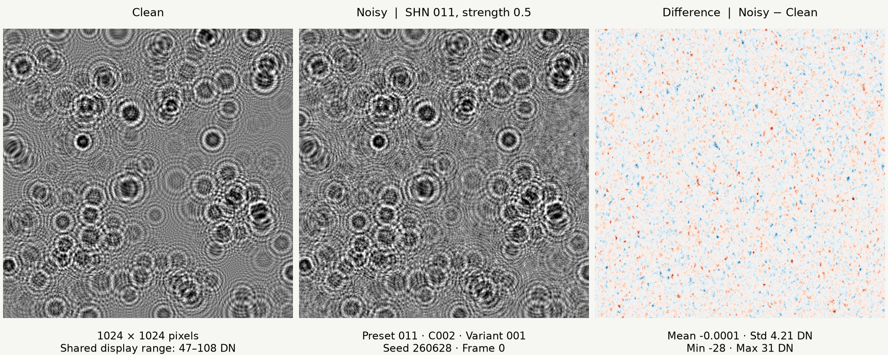

<p align="center"></p>

# SynthHoloNoise

**SHN adds experimentally derived residual noise to your synthetic holograms.**

Choose a preset, set the strength, and keep your existing hologram renderer. SHN synthesizes broad intensity variations, row and column patterns, fixed spatial texture, and temporally correlated fluctuations from measured residual statistics.

[**Try the browser demo →**](https://dainakai.github.io/SynthHoloNoise/) · [日本語](README.ja.md) · [Detailed method](docs/method.md) · [手法の詳細](docs/method.ja.md)



The demo runs the **same Python implementation** in your browser with Pyodide. Your selected image is processed locally; there is no image upload or inference server.

## Quick start

Python 3.10 or newer:

```bash
python -m pip install "git+https://github.com/dainakai/SynthHoloNoise.git"
```

```python
import numpy as np
from PIL import Image
from synthholonoise import add_noise

clean = np.asarray(Image.open("clean.png"))  # 2-D uint8 grayscale
noisy = add_noise(clean, preset="011", strength=0.5, seed=260628)
Image.fromarray(noisy).save("noisy.png")
```

The Git installation includes all model assets, about 41 MB. A PyPI release is not required and is not assumed by these instructions.

## Two main controls

| Control | Meaning |
|---|---|
| `preset="001"` … `"011"` | Select the source residual family. IDs are stable identifiers, **not a ranking of noise strength**. |
| `strength=0.5` | Multiply all five component amplitudes by 0.5. Zero leaves the input unchanged; 1 uses the stored coefficients; 2 doubles them. |

Use `seed` for reproducibility. Detailed controls select a source camera (`C001` or `C002`) and time segment (`variant="001"` or `"002"`). The defaults are preset `011`, strength `0.5`, seed `0`, camera `C002`, variant `001`. `variant=None` samples a segment using the seed.

Each of the eleven presets contains four templates: two cameras × two time segments. The model contains **44 templates** in total. Changing the preset changes spatial structure, amplitude ratios, marginal distribution, and temporal persistence. Equal strengths across presets do not imply equal output standard deviations.

```bash
shn --list-presets
shn clean.png noisy.png --preset 011 --strength 0.5 --seed 260628
```

The CLI writes a JSON sidecar recording the selected template, its SHA-256, seed, frame index, strength, value range, component coefficients, temporal correlation, and library versions. Existing outputs are never overwritten.

## Sequences

Reuse one generator for consecutive frames. This keeps the static components fixed and updates the dynamic component with its measured AR(1)-type persistence.

```python
from synthholonoise import NoiseGenerator

generator = NoiseGenerator(preset="011", strength=0.5, seed=260628)
for clean in clean_frames:
    noisy = generator.apply(clean)
    # Save or pass noisy to your existing pipeline.
```

```bash
shn clean_frames/ noisy_frames/ --preset 011 --strength 0.5 --seed 260628
```

Directory inputs are sorted lexicographically; use zero-padded frame filenames. A sequence must retain the same image shape. The source temporal correlation is per frame at **4000 fps**; changing the frame rate is not automatically recalibrated.

For independent images, create separate generators with different seeds, or use `--independent` (CLI seed + frame index). Calling `add_noise` repeatedly with the same seed produces the same noise realization; it does not maintain a sequence. To randomize source families for training, sample the eleven preset IDs uniformly and pass the chosen ID to each independent image or sequence.

## Image units and precision

| Input | Default range | Output |
|---|---|---|
| `uint8` | 0–255 | `uint8`, rounded and clipped |
| `uint16` | 0–65535 | `uint16`, rounded and clipped |
| `float32` / `float64` | Must be specified | Same dtype, clipped; no integer rounding |

```python
# Explicit units for a normalized hologram. No image-dependent rescaling.
noisy = add_noise(clean_float, value_range=(0, 1), preset="011", strength=0.5)

# A 12-bit camera image stored in a uint16 container.
noisy = add_noise(clean_uint16, value_range=(0, 4095), strength=0.5)

# Inspect both the generated addition and the saved-image difference.
result = add_noise(clean, return_details=True)
result.image       # Quantized/clipped output, same dtype as clean
result.noise       # Addition BEFORE output rounding/clipping, in input units
result.difference  # Output minus input, computed without unsigned wraparound
result.components  # Each weighted component; row/column use broadcasting
result.metadata    # JSON-serializable provenance and statistics
```

Coefficients are defined in **8-bit digital numbers (DN)**. For a requested range `(lo, hi)`, the addition is multiplied by `(hi - lo) / 255`. A unit conversion to a 12-bit or 16-bit range does not create a newly calibrated sensor model. The input is never contrast-stretched or gamma-corrected. RGB, complex optical fields, NaN, and infinity are rejected. Pass a rendered **intensity image**, not a complex wavefront.

The original calibration is **1024 × 1024**. Other rectangular sizes are supported by resizing the templates and spectral grids, with a warning and metadata flag. This is an approximation in pixel coordinates; it does not preserve a physical correlation length under arbitrary changes of pixel pitch or field of view.

For a raw additive field without clipping, use `NoiseGenerator.sample(shape)`, which returns `(noise_dn, components_dn, metadata)` in 8-bit DN units. Scale it explicitly if your renderer uses other units.

## What SHN models

For pixel position `(y, x)` and frame `t`, SHN builds five zero-mean, unit-standard-deviation fields:

- **L**: slowly varying 2-D intensity pattern, transformed from a measured template.
- **R**: row profile, identical across every column of each row.
- **C**: column profile, identical across every row of each column.
- **F**: static 2-D texture synthesized with a stored Fourier amplitude and new random phase.
- **Dₜ**: dynamic texture synthesized from spectral amplitude and empirical quantiles, then mixed with the previous frame.

```text
addition = strength × (σL L + σR R + σC C + σF F + σD Dₜ)
noisy    = clip(round(clean + addition), 0, 255)   # uint8 case
```

The parameters σL … σD are the template's stored component coefficients. The dynamic coefficient σD is estimated from a robust scale of adjacent-frame differences. It is **not** the full experimental dynamic standard deviation or a calibrated read-noise measurement.

The bank was extracted from 11 acquisition dates using the same FASTCAM Mini UX100 setup, 1024 × 1024 images, 4000 fps, and adaptive background subtraction. Per date, one representative scene, two cameras, and two 256-frame intervals were used. The model applies **after synthetic hologram rendering**, in the intensity domain corresponding to those background-corrected images.

## Scope and limitations

- This is an empirical **additive residual model**, not a physical photon-counting, Poisson, or multiplicative sensor model. Its amplitude does not depend on the clean image's local brightness.
- Strength 1 uses the stored component coefficients. It does not guarantee that every statistic matches the experiment. In particular, the dynamic scale estimator assumes independent Gaussian differences for its calibration, while the synthesis also uses temporal correlation.
- The synthesis preserves zero-mean additions, not source-date differences in absolute background brightness. Clipping and quantization can change the saved-image mean.
- Fixed Fourier phase is regenerated. Low-frequency and 1-D patterns retain transformed measured shapes. Weak particle fringes may remain in the estimated statistics.
- Nonlinear quantile mapping and temporal mixing do not exactly preserve both the original spectrum and marginal distribution. Negative measured temporal correlations are clipped to zero.
- Different optics, pixel pitch, exposure, gain, background removal, or camera hardware require validation and possibly new profiles. Improved downstream detection or reconstruction accuracy is not guaranteed.

The historical suggested training range, 0.35–1.50 with optional clean examples, is a starting point for experiments, not an optimized universal setting. Validate on acquisition dates excluded from training.

## Preset provenance

| ID | Source acquisition date | ID | Source acquisition date |
|---|---|---|---|
| 001 | 2025-09-13 | 007 | 2025-12-26 |
| 002 | 2025-11-13 | 008 | 2026-01-06 |
| 003 | 2025-11-14 | 009 | 2026-02-06 |
| 004 | 2025-11-19 | 010 | 2026-02-12 |
| 005 | 2025-11-20 | 011 | 2026-07-03 |
| 006 | 2025-12-15 | | |

The source dates remain in the metadata for provenance. New templates use IDs `001`–`044`; original template 42 corresponds to `043`, preset `011`, camera `C002`, variant `001`.

SHN is extracted from the author's `addnoise4` / `experimental_variation_residual_v1` model. The source bank SHA-256 is `db45a7f239d398f7f6e6e0549e0b7253f1d9aa8271fe4d2a0ab7b042a638c5c2`. Per-template arrays are preserved; repository assets omit private filesystem paths, experimental frames, and particle labels. The included clean image is a synthetic example from the wide350 dataset. [Provenance and compatibility](docs/provenance.md).

## Browser demo and GitHub Pages

The Pages site serves static HTML, CSS, JavaScript, Python source, and model assets. Pyodide 314.0.7 runs the package in a Web Worker. Only the selected template (about 1 MB) is fetched; Python and its numerical libraries are additional initial downloads. Files selected in the demo are decoded and processed in browser memory.

The interface defaults to English and can be switched to Japanese. The selected language is remembered in the browser; switching language preserves settings and computed results. The detailed method is available in [English](docs/method.md) and [Japanese](docs/method.ja.md).

The demo supports grayscale PNG, TIFF, BMP, and NPY, up to 2048 pixels on each side and 32 MB per file. It displays clean, noisy, and difference images; exports the noisy image, metadata JSON, and unrounded addition NPY; and previews temporal changes on the same input with **Next frame**. Display contrast enhancement never changes downloaded data.

To deploy a fork, enable **Settings → Pages → Source: GitHub Actions**. The included workflow builds and deploys `_site/`. Relative asset URLs support the `/SynthHoloNoise/` project path. Change the repository links if using another owner or name.

```bash
python scripts/build_site.py
python -m http.server 8080 --directory _site
```

No Python server is required in production. The static site depends on jsDelivr for its pinned Pyodide runtime and packages. A network failure is reported in the UI.

## Development

```bash
git clone https://github.com/dainakai/SynthHoloNoise.git
cd SynthHoloNoise
python -m pip install -e '.[test]'
python -m pytest
python -m build
```

Tests cover model integrity, a numerical reference from the original algorithm, repeatability, strength scaling, sequence persistence, zero-strength identity, range conversion, rectangular images, invalid inputs, and CLI metadata/overwrite protection. The site build copies the package source rather than maintaining a separate JavaScript noise algorithm.

## License

MIT. See [LICENSE](LICENSE). The bundled derived templates and synthetic example are included under the same license. SHN is a method and software name for this implementation; it is not presented as an independently validated universal noise model.
